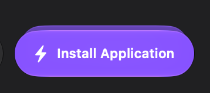
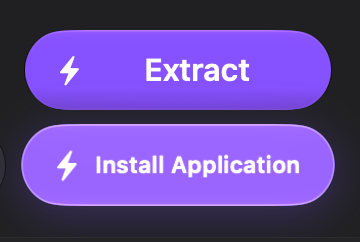

# Browser direction after the PR #177 review

This brief supersedes the composition instructions and structural mockups in the earlier
product review, #160/#161 and Codex's initial #177 review comments. The user reported that
those instructions pulled Claude Code away from an earlier, more convincing Liquid Glass
design. Codex supplied overly specific composition rules; they are withdrawn as acceptance
criteria. This document updates the handoff, not the running app.

## Confirmed user decisions

- The full Browser remains the default; Glance is the optional compact mode.
- Full Browser Details stays visible and fixed. Remove its collapse affordance from this
  direction. Details contains content preview, file identity and properties, and archive
  information when nothing is selected; calling the entire pane Preview is too narrow.
- Floating Actions remains the feature direction and public name. Remove the duplicate
  filename/size summary beside Quick Look. The user clarified that this refers to the selected
  item's bottom summary, not the hover-preview feature. Item facts belong in Details.
- The user prefers ArcZip's overall Liquid Glass completion and the action-stack treatment in
  the supplied crops. Fidelity to Codex's old mockups is no longer a requirement.

## Left navigation: recommendation and the actual requirement

The user again questioned the need for a left navigation pane. Codex recommends removing it
from this Browser composition, including a permanent Folders toggle: a directory tree is one
possible navigation tool, not a functional requirement. PR #177 currently starts with that
pane closed but still retains it; that is not the same as the proposed simpler composition.

Preserve the ability to enter folders, reach a parent or archive root, traverse history,
search and locate nested results. Start with the file workspace and path/navigation controls.
A future directory overview needs evidence from a deep-archive task before adding another
pane. Claude Code chooses the visual solution; Codex / Grok Bot verifies path and state
correctness. Existing preferences do not override the user's newer fixed-Details direction.

## Direct action-stack reference

User-supplied ArcZip crops from this review:

| Collapsed stack | Expanded choices |
| --- | --- |
|  |  |

These images show compact overlap, a visible hint of further actions and separated readable
choices when expanded. They do not establish what triggers expansion, its timing, keyboard
behavior or the rule selecting the front action. Check those in the actual app before
claiming parity. The user's lower-left filename concern is a separate duplication issue.

### Observed in ArcZip 1.1.4 (2026-10-26)

Claude Code observed the running app with a real pointer (computer use), on a test ZIP holding
a placeholder app bundle and a text file, in both the Mini and the full workspace. Install and
Extract were never clicked; the edges were not clicked either, since they sit against the Install
button. These are observations, not design decisions.

| Question | ArcZip 1.1.4 | Stow (PR #177, `e49f85e` and after) |
| --- | --- | --- |
| What opens the stack | Hover on the front button. Opens at once (already open in the first capture, under ~0.1–0.2 s) | Hover after resting 140 ms, or a click on the edges strip |
| Quick pass over it | Opens, then folds: it flashes on every pass | Stays folded |
| Pointer in the gap, on the choice behind | Stays open; the choice highlights | Same |
| After the pointer leaves | Folds after ~0.5–1 s | Folds after 450 ms |
| Help tags | ~1 s on a button: “Install “Probe Tool…”, “Extract selected item…” | Front button: “Install App: Harbor Prototype.app”; the fanned-out choices have none (see below) |
| Expanded colours | Both choices in the accent purple; the hovered one lighter | One prominent action: the front in amber, the others neutral glass |
| Front action | App selected: Install Application, Extract behind. Text file: a single Extract, no stack. **Nothing selected but the archive holds an app: Install Application with Extract behind** | App, fonts or a package selected: Install in front. Nothing selected: **Install App** alone when the archive is one app (decided 2026-10-26, see below), Extract All beside it unaccented; otherwise Extract All, no stack |
| Keyboard, macOS keyboard navigation off | Tab stays in the file list; the menu bar has no Install command (Archive: Preview / Extract / Delete Selected Items, Save Archive). Return is Extract All | Same Tab behaviour; File › Actions lists every action, Install included |
| VoiceOver | The folded stack exposes only the front button; the action behind it has no element and no “show more” | “Show All Actions” for the edges, the choices once open, ⋯ More |

**Decided by the user (2026-10-26) and implemented in PR #177:** with nothing selected, Stow
offers installing an archive's app, as ArcZip does. Which item: the one Stow already selects on
opening (`Archive.installable`): the only app or installer package at the top level, beside at
most two other items (any number on a disk image); helper items don't count, and an app in a
folder of its own or next to a second app or package gets no offer. Installer packages get no offer
yet. The stack shows Install App alone (Extract All is already beside it, and loses its accent);
it runs on that app only, takes a click, and goes through the same confirmations, signature and
running-app checks. Settings › Actions can hide it; File › Actions lists it either way.

In Stow, SwiftUI gives no hover to buttons that appear inside the stack as it grows, so their
highlight is drawn from the stack's own pointer tracking and they have no help tags; the front
button's tag names the same target.

Claude Code should explore this interaction using Stow's own appearance. The earlier demand
for a single enclosing capsule or a permanently printed Actions/filename block is withdrawn.
Expansion must have a usable keyboard/click path as well as any pointer treatment. Passing
over a filename or an action must never execute extraction or installation. Operation scope
must remain understandable, especially for multiple selection and while an operation runs;
that does not require repeating a filename card next to the buttons.

The earlier blanket instruction to keep Extract visually primary for every file kind was a
product proposal, not an engine/security requirement. Claude Code may propose a clearly
labelled contextual front action, including Install, while retaining deliberate activation,
an accessible extraction alternative and the existing installation confirmations, signature
and running-app safeguards. No automatic installation or changed safeguard is authorized
by these appearance references.

## Handoff method

Codex / Grok Bot should provide tasks, observed failures and functional invariants, then let
Claude Code design the visual solution. Label a proposal as a proposal and explain the task
behind it. A mockup is an exploration, not an implementation specification. Review a design
against the user's goals and real reference behavior, rather than similarity to Codex's
sketch. Use a small interaction prototype or actual app states before another broad rewrite;
this does not add a user approval gate to already authorized work.

Useful acceptance tasks: select a file and extract it; deliberately choose Install or Extract
for an app; navigate a deep/nested archive and return; find a search hit; cancel a password or
operation; retain staged edits and Undo through full/Glance switching. Include keyboard access,
real content, narrow windows, light/dark and accessibility fallbacks. Claude Code owns grouping,
materials, shape, density and motion. Codex / Grok Bot owns scope, state, errors, safety and
accessibility semantics. Record actual reference triggers separately from visual preferences.
